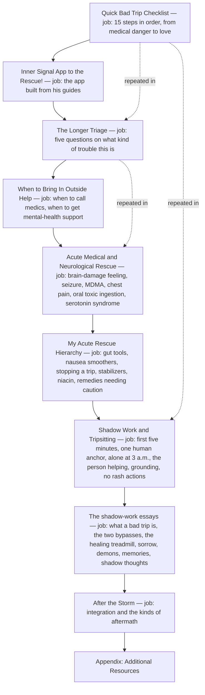
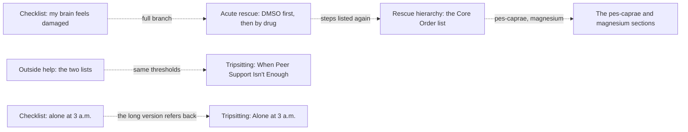

# Bad Trips guide architecture

<!-- article-id: bad-trips -->

Indexes: `articles/bad-trips/CURRENT-STATE.md` + `articles/bad-trips/master.md`

This graph is a visual index over canonical article state. If it conflicts with registered authority, repair the graph.

## Overview

His guide as it stands in his post (2026-11-03): a quick checklist, a second, longer triage, the call-for-help lists,
the medical and neurological emergencies, his rescue remedies, then the tripsitting how-to and the shadow-work essays,
integration and resources. The same advice runs through several of these parts (the round-1 marking page,
`review/r01/`, maps the repeats); the structure question there decides how the quick and long parts split the work.

## Important dependencies

## Authority / placement notes

- Current topology: his post as of 2026-11-03 (`master.md`); nothing has moved yet.
- Unresolved placement questions: how the quick checklist and the long guide split the work, and where "Hello, Lovey Bunny!"
  sits (`OWNER-QUESTIONS.md`, questions 1 and 3; the round-1 page's cards ST-1 and Q-2).
- Protected functions: the remedies' fidelity (every remedy, dose, unit, timing and warning) and the call-for-help
  thresholds that stay inside each emergency (`OWNER-LOCKS.json`).

## Update rule

Update this file in the same substantive change whenever section order, protected-function placement, owner supersession
routing, setup/payoff dependencies, or the real stopping point changes. Cosmetic prose edits do not require graph churn.
