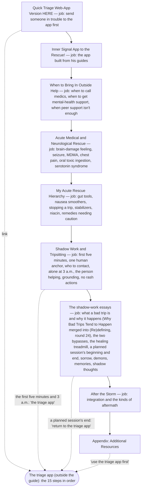
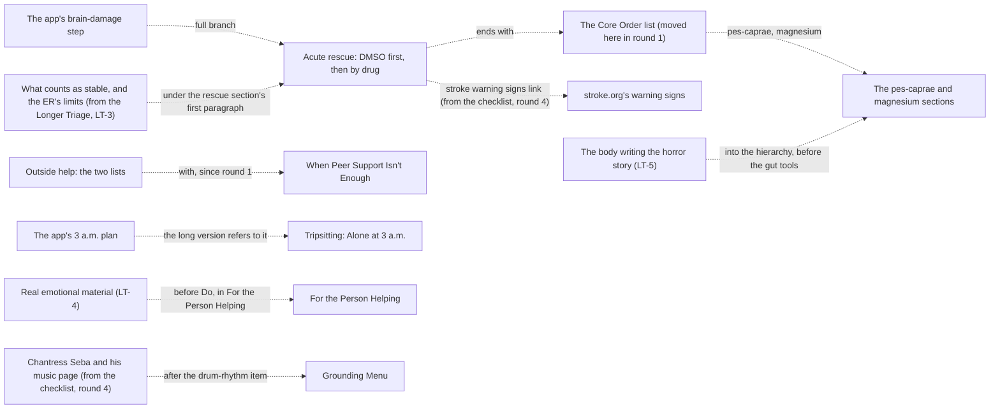

# Bad Trips guide architecture

<!-- article-id: bad-trips -->

Indexes: `articles/bad-trips/CURRENT-STATE.md` + `articles/bad-trips/master.md` + `articles/bad-trips/GUIDE-SO-FAR.md`

This graph is a visual index over canonical article state. If it conflicts with registered authority, repair the graph.

## Overview

His guide after round 4 (`GUIDE-SO-FAR.md`; his post itself is `master.md`): the link to the triage app, his picture,
Inner Signal App to the Rescue!, the call-for-help section (with When Peer Support Isn't Enough in it), the medical and
neurological emergencies (the brain-damage section ends with the Core Order list), his rescue remedies, then the
tripsitting how-to and the shadow-work essays, integration and resources. The quick checklist is gone: its steps are the
triage app (https://ibogaqueen.com/1625-2/, version 9 live since his message of 2026-11-04 14:58 UTC, "updated the web
app"), and the guide's four mentions of the checklist point at the app (round 4's APP-1 to APP-4). The three things only
the checklist said moved into the long part in his words: the stroke warning signs link (the brain-damage checks), the
Chantress Seba line with his music page (the grounding menu) and his love page link (the sorrow heading). The Longer
Triage went in round 2 (his structure answer ST-1, A, 2026-11-03 18:59 UTC); the four things only it said moved into the
long part (LT-2 to LT-5).

## Important dependencies

## Authority / placement notes

- Current topology (2026-11-08): the guide after round 24 (`humanize/h32-20261108/`: his round-24 versions, the dash swap, Why Bad Trips Tend to Happen said once under his (Re)defining "Bad Trip", the guide made drug-neutral where it speaks generally). Rounds 5 to 23 (the other account, 2026-11-05 to 07) cut repeats across the long part (Minimum Viable Integration among them, round 23) and put in his versions; their records are in the handoff note. Before that, the guide after round 4 (`review/r04/GUIDE-AFTER-R04.md`, made by `review/r04/apply_r04.py` from
  round 3's guide, `review/r03/GUIDE-AFTER-R03.md`, and his round-4 answers) as `GUIDE-SO-FAR.md`. Each round's apply
  script reads the round before's frozen output: round 2's guide, then the standard typographic swap
  (`humanize/h01/swap.py`, writing `humanize/h01/GUIDE-AFTER-SWAP.md`), round 3, round 4. Round 4 took the checklist out
  (the app has it), pointed the four mentions at the app, re-homed the checklist's three unique items, and put in W-CBD2.
  From round 2: the Longer Triage gone; its reassuring-screen line in the brain-damage checks, what counts as stable and
  the ER's limits under the rescue section's first paragraph, real emotional material before Do, and the body writing the
  horror story in the hierarchy. From round 1: When Peer Support Isn't Enough in When to Bring In Outside Help; the Core
  Order list in the brain-damage section; one appendix heading.
- Settled placements: "Hello, Lovey Bunny!" stays where it opens the shadow-work half (Q-2, a); the support lines stay
  in Get One Human Anchor (Q-8, a); the seizure threshold stays in both the medics list and Active Seizure (SF-2). All
  of them, with his words, are in `KEEP-AS-IS.json`.
- Protected functions: the remedies' fidelity (every remedy, dose, unit, timing and warning) and the call-for-help
  thresholds that stay inside each emergency (`OWNER-LOCKS.json`).

## Update rule

Update this file in the same substantive change whenever section order, protected-function placement, owner supersession
routing, setup/payoff dependencies, or the real stopping point changes. Cosmetic prose edits do not require graph churn.
