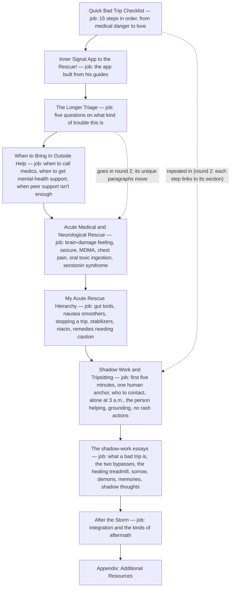
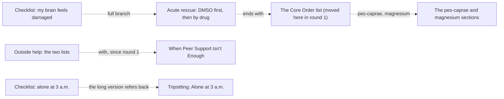

# Bad Trips guide architecture

<!-- article-id: bad-trips -->

Indexes: `articles/bad-trips/CURRENT-STATE.md` + `articles/bad-trips/master.md` + `articles/bad-trips/GUIDE-SO-FAR.md`

This graph is a visual index over canonical article state. If it conflicts with registered authority, repair the graph.

## Overview

His guide after round 1 (`GUIDE-SO-FAR.md`; his post itself is `master.md`): a quick checklist, a second, longer
triage, the call-for-help section (now with When Peer Support Isn't Enough in it), the medical and neurological
emergencies (the brain-damage section now ends with the Core Order list), his rescue remedies, then the tripsitting how-to
and the shadow-work essays, integration and resources. His structure answer (ST-1, A, 2026-11-03 18:59 UTC): the
checklist keeps each step's heading and one or two of his lines with a link to its section, and the Longer Triage goes,
its few unique paragraphs moving into the long part; round 2's page (`review/r02/`) proposes each step and move.

## Important dependencies

## Authority / placement notes

- Current topology: the guide after round 1 (`GUIDE-SO-FAR.md`, made by `review/r01/apply_r01.py` from his post and his
  round-1 answers): When Peer Support Isn't Enough moved into When to Bring In Outside Help; the Core Order list moved
  into the brain-damage section; the appendix has one heading.
- Settled placements: "Hello, Lovey Bunny!" stays where it opens the shadow-work half (Q-2, a); the support lines stay
  in Get One Human Anchor (Q-8, a). Open: round 2's cards (`review/r02/`).
- Protected functions: the remedies' fidelity (every remedy, dose, unit, timing and warning) and the call-for-help
  thresholds that stay inside each emergency (`OWNER-LOCKS.json`).

## Update rule

Update this file in the same substantive change whenever section order, protected-function placement, owner supersession
routing, setup/payoff dependencies, or the real stopping point changes. Cosmetic prose edits do not require graph churn.
