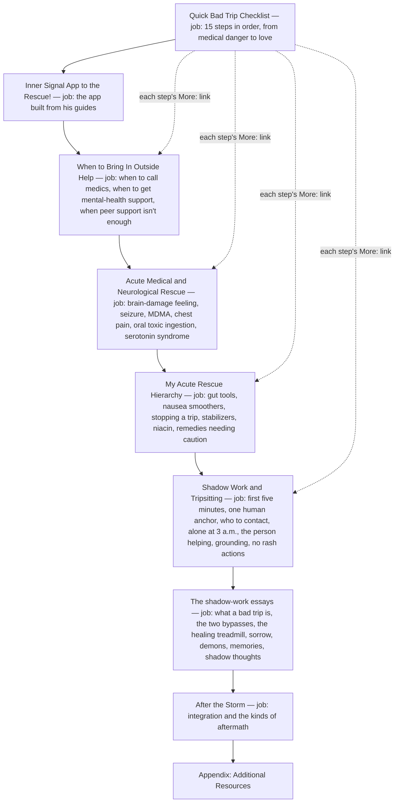
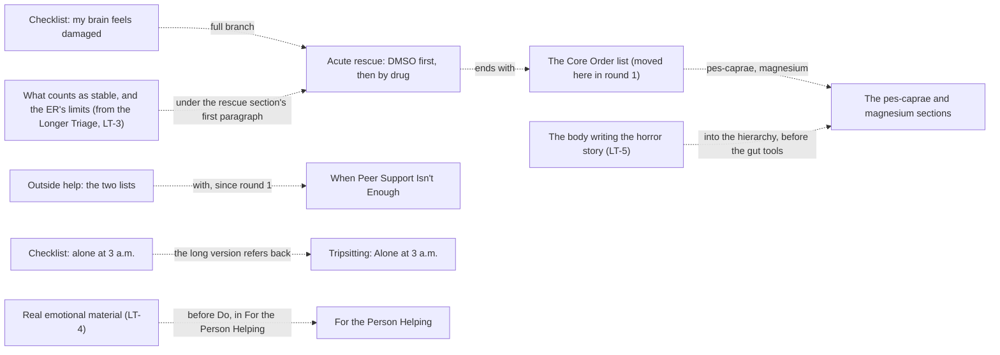

# Bad Trips guide architecture

<!-- article-id: bad-trips -->

Indexes: `articles/bad-trips/CURRENT-STATE.md` + `articles/bad-trips/master.md` + `articles/bad-trips/GUIDE-SO-FAR.md`

This graph is a visual index over canonical article state. If it conflicts with registered authority, repair the graph.

## Overview

His guide after round 2 (`GUIDE-SO-FAR.md`; his post itself is `master.md`): a quick checklist whose 15 steps each
keep their heading and one or two of his lines and end with "More:" and a link to their section, the call-for-help
section (with When Peer Support Isn't Enough in it), the medical and neurological emergencies (the brain-damage section
ends with the Core Order list), his rescue remedies, then the tripsitting how-to and the shadow-work essays, integration
and resources. The Longer Triage is gone (his structure answer ST-1, A, 2026-11-03 18:59 UTC, carried out by round 2's
cards, all approved 2026-11-04 10:26 UTC); the four things only it said moved into the long part (LT-2 to LT-5).

## Important dependencies

## Authority / placement notes

- Current topology: the guide after round 2 (`review/r02/GUIDE-AFTER-R02.md`, made by `review/r02/apply_r02.py` from
  round 1's guide, `review/r01/GUIDE-AFTER-R01.md`, and his round-2 answers), with the standard typographic swap
  (`humanize/h01/swap.py`) as `GUIDE-SO-FAR.md`: the checklist's steps short, each with its More: link; the Longer Triage
  gone; its reassuring-screen line in the brain-damage checks, what counts as stable and the ER's limits under the rescue
  section's first paragraph, real emotional material before Do, and the body writing the horror story in the hierarchy.
  From round 1: When Peer Support Isn't Enough in When to Bring In Outside Help; the Core Order list in the brain-damage
  section; one appendix heading.
- Settled placements: "Hello, Lovey Bunny!" stays where it opens the shadow-work half (Q-2, a); the support lines stay
  in Get One Human Anchor (Q-8, a); the seizure threshold stays in both the medics list and Active Seizure (SF-2). All
  of them, with his words, are in `KEEP-AS-IS.json`.
- Protected functions: the remedies' fidelity (every remedy, dose, unit, timing and warning) and the call-for-help
  thresholds that stay inside each emergency (`OWNER-LOCKS.json`).

## Update rule

Update this file in the same substantive change whenever section order, protected-function placement, owner supersession
routing, setup/payoff dependencies, or the real stopping point changes. Cosmetic prose edits do not require graph churn.
