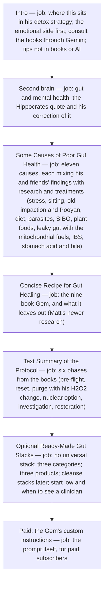

# Healing the Gut architecture

<!-- article-id: healing-the-gut -->

Indexes: `articles/healing-the-gut/CURRENT-STATE.md` + `articles/healing-the-gut/master.html`

This graph is a visual index over canonical article state. If it conflicts with registered authority, repair the graph.

## Overview

His gut article as it stands in his post (2026-11-03). Joel: the second part "is a recipe based on various books while the first part also includes some research i and my friends have done ourselves, so i'd like to figure out how to line them up better." This map is the order as imported; the restructuring is open.

