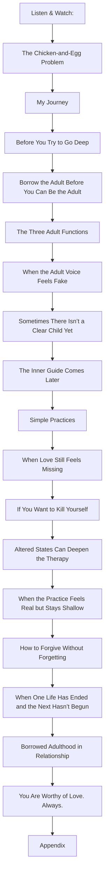
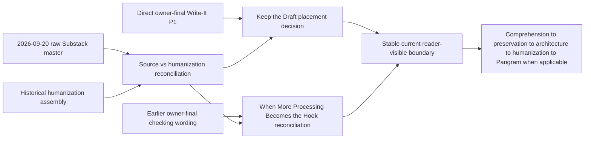

# Inner Child Therapy architecture

<!-- article-id: inner-child-therapy -->

Indexes: articles/inner-child-therapy/CURRENT-STATE.md + articles/inner-child-therapy/master.html

This graph indexes the exact registered working Substack source. It does not imply that every current paragraph has completed humanization, citation review, or owner-final review. Direct current Joel corrections outrank the graph and are reconciled through current state/owner locks.

## Overview

## Active reconciliation dependencies

## Authority / placement notes

- master.html is exact current raw-source authority, not whole-article owner-final prose.
- Historical humanization files are derived evidence, not competing masters.
- Joel's direct owner-final Write-It P1 is higher semantic authority but absent from the raw source and remains placement-reconciliation pending.
- The new checking section occupies functions previously held by owner-final evaluation/stop prose. Do not decide that conflict from timestamp or detector status alone.
- Native/editor object order is indexed in SOURCE-STRUCTURE-INVENTORY-20260920.json.
- No publication export is registered.

## Update rule

Update this file whenever section order, protected-function placement, owner supersession routing, or the real stopping point changes. Cosmetic wording edits do not require graph churn.

## Owner-clarified therapy trajectory and lifelong growth (2026-10-14)

The guide's When Healing Turns Into Checking addresses compulsive rechecking and decreasing reliance on formal therapy as skills develop. It does not say that treatment must end, that it cannot be useful again, or that growth ever ends.

~~~mermaid
flowchart LR
  guidance["Early guidance: guide or parenting books"] --> practice["Deliberate Nurturer, Protector and Guide responses"]
  practice --> habitual["Those responses become more natural, second nature"]
  habitual --> lighter["Less formal practice and less daily guide-checking"]
  lighter --> return["Formal support can still be revisited when useful"]
  habitual --> growth["Lifelong differentiation, wisdom and compassion"]
  checking["Compulsive review as a ritual before living"] -. "different from" .-> return
~~~

**Cross-section meaning and protected functions:**

- **When Healing Turns Into Checking:** retain the owner's claim that if therapy works, the need for *formal therapy* should generally decrease. Zero formal therapy might be ideal but is not a requirement or promise. The real-parenting analogy is an essential illustration: a parent might consult books and plan responses at first, then gradually get into the groove. Similarly the Nurturer, Protector and Guide become more automatic rather than requiring scripted daily dialogue or rereading this guide.
- **The same checking passage:** distinguish rituals of reassurance/overprocessing from useful reflection and renewing structured support when needed. Keep the subsequent claim about improvement in ordinary life and the inner child–adult relationship and the warning against a ritual before living.
- **Sometimes There Isn't a Clear Child Yet → Untangling the Belonging Bargains:** keep the sentence “Differentiation is slow, and it goes on your whole life.” intact. Ongoing growth in wisdom and compassion does not imply unchanging reliance on formal practice.
- **Placement:** revise the potentially misleading “just like real growing up is not something you do forever” in the checking section, **not** the differentiation passage. Proposed wording is pending in OWNER-EDITS.json, not silently accepted as published prose.

This is Joel's direct 2026-10-14 clarification following two mistaken editorial interpretations. Do not infer empirical rates of therapy completion from it.
