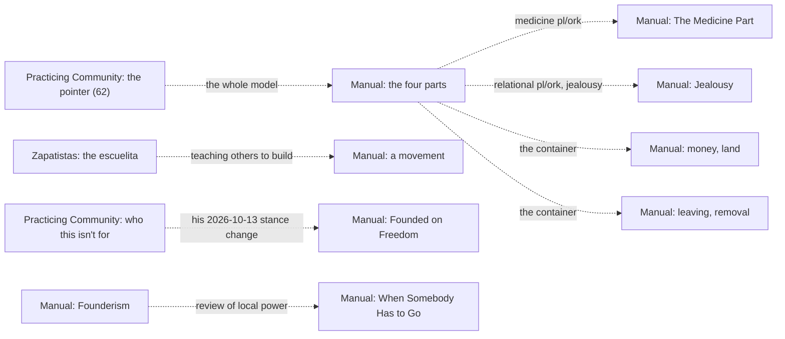

# Intentional Communities architecture

<!-- article-id: intentional-communities -->

Indexes: `articles/intentional-communities/CURRENT-STATE.md` + `articles/intentional-communities/original.md`

This graph is a visual index over canonical article state. If it conflicts with registered authority, repair the graph.

## Overview

Since Joel's 61 b and 62 (2026-10-23 22:29 UTC), the article is an essay and then a How-To Manual on the same post, with
the appendix last. The section names are his final paste of 2026-10-20 (his own edits renamed and grouped some of the
sections this map had before).

```mermaid
flowchart TD
    subgraph essay["The essay"]
        e1["The New Age May Dawn Suddenly — job: open with his father's 1988 film and the question of how people could live together"]
        e2["Communes Are Hot Again — job: why communal living is drawing people now, and the freeloader problem"]
        e3["Why Communities Keep Dying in the Same Two Ways — job: the secular failure and the spiritual failure"]
        e4["Practicing Community Can Start Now — job: start now: values, a practice group, the math of absorption, who this isn't for, visitor to member; points down to the manual"]
        e5["The Best Model I've Seen: Zapatistas — job: the closest whole example, its limits, and the escuelita"]
        e6["What Community Looks Like From Sénégal — job: his own setting, its limits, and the black tax"]
        e7["A Hope For Humanity — job: the essay's close"]
    end
    subgraph manual["How-To Manual"]
        m1["The Four Parts That Have to Pl/ork Together — job: the model: inner, relational and medicine pl/ork inside the container"]
        m2["The Medicine Part - Yes, I'm Naming It — job: psychedelics in community, and his ceremony principles"]
        m3["Which Connections to the Technosphere Do You Keep? — job: technology, and hope in the polycrisis"]
        m4["Jealousy Can Capture Monogamy or Free Love — job: jealousy in any relationship form"]
        m5["The Grown Children Get the Final Review — job: raising children together, and the door opening outward at adulthood"]
        m6["Money, Land, and Shared Resources — job: the common purse and moving beyond money"]
        m7["Founderism: The Four Questions — job: founders' power, and how a model becomes a cult"]
        m8["From One Community to a Movement — job: experimenting before splitting, and federating"]
        m9["Leaving, Removal, and Dissolution — job: leaving, removing someone, and ending well"]
    end
    app["Appendix: Watch These, Then Read These — job: films and reading"]

    e1 --> e2 --> e3 --> e4 --> e5 --> e6 --> e7 --> m1 --> m2 --> m3 --> m4 --> m5 --> m6 --> m7 --> m8 --> m9 --> app
```

## Important dependencies

## Authority / placement notes

- Current topology: the essay, then the How-To Manual, then the appendix (his 61 b and 62). The registered master is
  `master.md`, since 2026-10-25 the new version (`candidate/joel-20261024/answer65/WORKING.html`, his editor HTML of
  2026-10-20 with his answers 57 to 65 and his kibbutz image) as Markdown (`PROMOTION-RECEIPT-20261017.md`, "Changes
  since"); it read Human Written as one text. The published text first imported stays as `original.md`, the published
  source. The manual repeats a few essay points on purpose, for readers who go straight to it (his 61 b); his 65 (E260)
  cut the previews of later sections.
- Live placement question, from before the move: the stance check asked how the Zapatista section's P9 and P11 (power
  drifting up and being pushed back down) fit "When Somebody Has to Go", now in the manual's "Leaving, Removal, and
  Dissolution", which cites the Zapatistas as a layer that reviews local power.
- Protected functions: each one in `OWNER-LOCKS.json` sits in the manual's four parts, in "Who This Isn't For" and the
  opening (healing first), or applies to the whole article.

## Update rule

Update this file in the same substantive change whenever section order, protected-function placement, owner supersession routing, setup/payoff dependencies, or the real stopping point changes. Cosmetic prose edits do not require graph churn.
