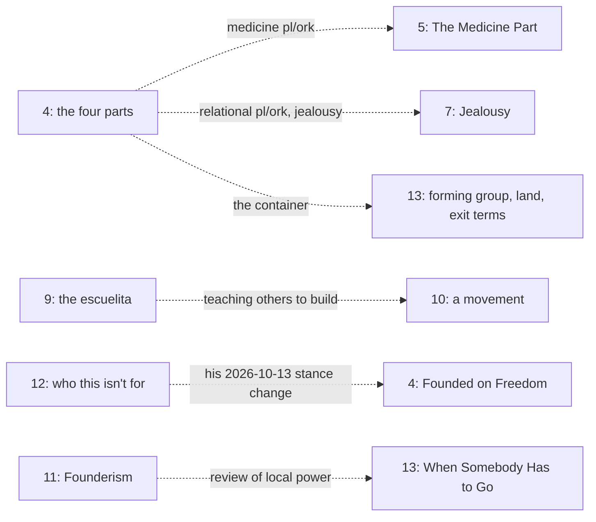

# Intentional Communities architecture

<!-- article-id: intentional-communities -->

Indexes: `articles/intentional-communities/CURRENT-STATE.md` + `articles/intentional-communities/original.md`

This graph is a visual index over canonical article state. If it conflicts with registered authority, repair the graph.

## Overview

```mermaid
flowchart TD
    s1["1. The New Age May Dawn Suddenly — job: open with his father's 1988 film and the question of how people could live together"]
    s2["2. Communes Are Hot Again — job: why communal living is drawing people now"]
    s3["3. Why Communities Keep Dying in the Same Two Ways — job: the secular failure and the spiritual failure"]
    s4["4. The Four Parts That Have to Pl/ork Together — job: the model: inner, relational and medicine pl/ork inside the container"]
    s5["5. The Medicine Part - Yes, I'm Naming It — job: psychedelics in community, and his ceremony principles"]
    s6["6. Which Connections to the Technosphere Do You Keep? — job: technology, and hope in the polycrisis"]
    s7["7. Jealousy Can Capture Monogamy or Free Love — job: jealousy in any relationship form"]
    s8["8. The Grown Children Get the Final Review — job: raising children together, and the door opening outward at adulthood"]
    s9["9. The Best Model I've Seen: Zapatistas — job: the closest whole example, its limits, and the escuelita"]
    s10["10. From One Community to a Movement — job: experimenting before splitting, and federating"]
    s11["11. Founderism: The Four Questions — job: founders' power, and how a model becomes a cult"]
    s12["12. The Math of Absorption, and Who This Isn't For — job: free resource, need, and fit"]
    s13["13. Your Little Forming Group Already Is the Community — job: start now: values, land, exit terms, membership, removal"]
    s14["14. Dissolution and Exit — job: ending well"]
    s15["15. What This Looks Like From Sénégal — job: his own setting, and the black tax"]
    s16["16. Practice Comes Before Property — job: what to do now, wherever you live"]
    app["Appendix: Watch These, Then Read These — job: films and reading"]

    s1 --> s2 --> s3 --> s4 --> s5 --> s6 --> s7 --> s8 --> s9 --> s10 --> s11 --> s12 --> s13 --> s14 --> s15 --> s16 --> app
```

## Important dependencies

## Authority / placement notes

- Current topology: the published section order. The registered master is `master.md`, the humanized article Joel accepted (45 a, `PROMOTION-RECEIPT-20261017.md`), built from the working copy `candidate/HUMANIZED-SO-FAR.md` without its version notes; the published text stays as `original.md`, the published source. Both keep the published section order. Joel's section 4 of 2026-10-13 moved paragraphs inside that section only (the pl/ork definition and the leaking paragraph up under the four-parts heading; "Founded on Freedom" in place of "One principle runs through all of them").
- Live placement question: the stance check asks how his section 9 P9 and P11 (Zapatista power drifting up and being pushed back down) fit "When Somebody Has to Go" in section 13, which cites the Zapatistas as a layer that reviews local power. It's on the lane's questions page.
- Protected functions: each one in `OWNER-LOCKS.json` sits in section 4 (the four parts), section 12 and the opening (healing first), or applies to the whole article.

## Update rule

Update this file in the same substantive change whenever section order, protected-function placement, owner supersession routing, setup/payoff dependencies, or the real stopping point changes. Cosmetic prose edits do not require graph churn.
