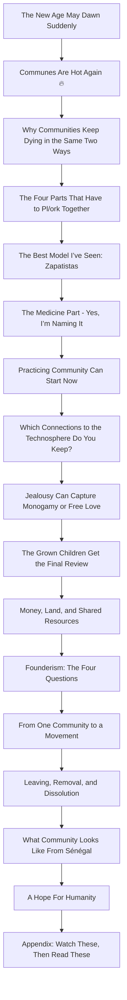
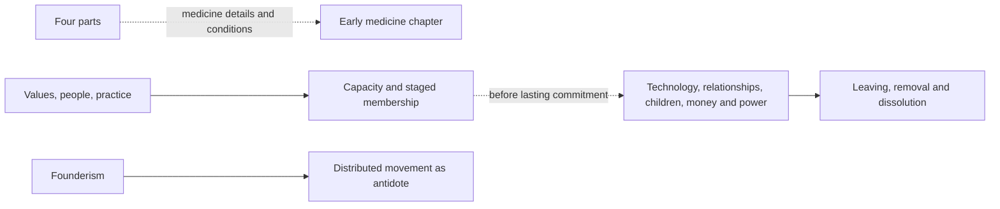

# Intentional Communities architecture

<!-- article-id: intentional-communities -->

Current article: `master.html`, r04-approved. Historical published raw source: `original.md`. Owner corrections: `candidate/owner-approved-20261020/OWNER-CORRECTION-RECEIPT.json`.

## Overview

## Important dependencies

## Authority / placement notes

The article presents its distinctive medicine topic early; reading order does not waive its preparation/competence requirements. The practice chapter leads from values through staged participation. Detailed obligations precede exit. Founderism and movement remain adjacent. The owner-directed medicine opener establishes public relevance before the personal-model rationale. The closing personal invitation precedes the reading appendix.

## Update rule

Update this map when a later authorized edit changes heading relationships, placement or references. It is an index, not independent article authority.
