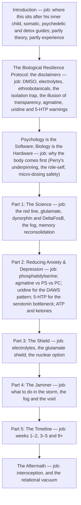

# Neuro De-Armoring architecture

<!-- article-id: neuro-de-armoring -->

Indexes: `articles/neuro-de-armoring/CURRENT-STATE.md` + `articles/neuro-de-armoring/master.md`

This graph is a visual index over canonical article state. If it conflicts with registered authority, repair the graph.

## Overview

His protocol article as it stands in his post (2026-11-02): the warnings first, then why the protocol works on the body
before the mind, the science, the tools by state, the acute fixes and the eight-week timeline. Every compound, dose, unit,
timing and warning in it is held by `humanize/FIDELITY-KEYS.json`.

