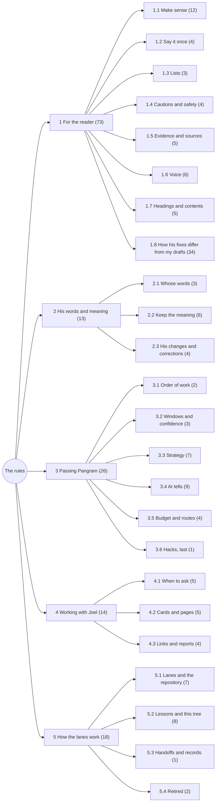

# The rule tree

Every rule the editor follows on Joel's articles, once, in a branch named for what it protects: the reader first, his words next, passing Pangram after those (hacks last), then working with Joel and how the lanes work. Where an older file says otherwise, this tree wins (AGENTS.md). Why this shape: [BRAINSTORM.md](BRAINSTORM.md).

**The human view** (the tree, a map of the links, and what every term means): https://claude.ai/artifact/RPYerG1RZ1iNwECeaBTSZk

The source is [TREE.md](TREE.md); `python3 rules/build_tree.py` checks it and writes this page, [tree.json](tree.json) and the view. Built 2026-11-28 15:41 UTC; checks: [CHECKS.md](CHECKS.md).

## 1 For the reader

Rules that make an article easy and worthwhile to read; they come before anything about Pangram.

### 1.1 Make sense

- [Gauge the audience: it decides how much to explain](TREE.md#r-gauge-audience--gauge-the-audience-it-decides-how-much-to-explain)
- [The reader knows early why they are reading this](TREE.md#r-payoff-first--the-reader-knows-early-why-they-are-reading-this)
- [Each sentence, paragraph and idea shows how it follows](TREE.md#r-connect--each-sentence-paragraph-and-idea-shows-how-it-follows)
- [Explain for the reader the article is written for](TREE.md#r-explain-hidden-links--explain-for-the-reader-the-article-is-written-for)
- [The word that says exactly what the thing does](TREE.md#r-accurate-word--the-word-that-says-exactly-what-the-thing-does)
- ["It" where it is clear, the name where it isn't](TREE.md#r-clear-it--it-where-it-is-clear-the-name-where-it-isnt)
- [Explain a term where the reader first needs it](TREE.md#r-gloss--explain-a-term-where-the-reader-first-needs-it)
- [Join sentences only where the stretch reads choppy](TREE.md#r-join-choppy--join-sentences-only-where-the-stretch-reads-choppy)
- [Quotation marks where a "said" word wouldn't parse without them](TREE.md#r-quote-what-is-said--quotation-marks-where-a-said-word-wouldnt-parse-without-them)
- [What he says in chat is fitted to the article](TREE.md#r-fit-his-chat-words--what-he-says-in-chat-is-fitted-to-the-article)
- [Every article is checked for statements that can't both hold](TREE.md#r-contradictions-check--every-article-is-checked-for-statements-that-cant-both-hold)
- [A close word-by-word read for sense before a post](TREE.md#r-close-read--a-close-word-by-word-read-for-sense-before-a-post)

### 1.2 Say it once

- [Cut a repeat, a second explanation or filler when the article reads better without it](TREE.md#r-cut-repeats--cut-a-repeat-a-second-explanation-or-filler-when-the-article-reads-better-without-it)
- [Every cut or merge can be seen and put back](TREE.md#r-cuts-shown--every-cut-or-merge-can-be-seen-and-put-back)
- [Point to the other section instead of saying it again](TREE.md#r-link-not-repeat--point-to-the-other-section-instead-of-saying-it-again)
- [Across his Substack, one link per thing and one copy per shared passage](TREE.md#r-shared-links-and-passages--across-his-substack-one-link-per-thing-and-one-copy-per-shared-passage) *(open question)*

### 1.3 Lists

- [A list only where one is really needed](TREE.md#r-lists-only-when-needed--a-list-only-where-one-is-really-needed)
- [Unpack a list where its audience needs each item explained](TREE.md#r-unpack-lists--unpack-a-list-where-its-audience-needs-each-item-explained)
- [Don't fill a list to cover every hole](TREE.md#r-lists-not-overfull--dont-fill-a-list-to-cover-every-hole) *(open question)*

### 1.4 Cautions and safety

- [Few cautions, each said once, none that treats the reader as an idiot](TREE.md#r-few-cautions--few-cautions-each-said-once-none-that-treats-the-reader-as-an-idiot)
- ["Safe" has to be needed and clear](TREE.md#r-safe-word--safe-has-to-be-needed-and-clear)
- [A model's caution is checked against his words and its source](TREE.md#r-model-cautions-checked--a-models-caution-is-checked-against-his-words-and-its-source)
- [His harm-reduction warnings stay, by meaning and facts](TREE.md#r-his-warnings-stay--his-harm-reduction-warnings-stay-by-meaning-and-facts)

### 1.5 Evidence and sources

- [In a science article, get the science right before the wording](TREE.md#r-science-first--in-a-science-article-get-the-science-right-before-the-wording)
- [No benefit or risk wider or vaguer than the sources show](TREE.md#r-claims-match-sources--no-benefit-or-risk-wider-or-vaguer-than-the-sources-show)
- [Cite a study only where the reader expects evidence, and ask at the start how much research the article carries](TREE.md#r-studies-where-expected--cite-a-study-only-where-the-reader-expects-evidence-and-ask-at-the-start-how-much-research-the-article-carries)
- [Once he says his experience stands, it is written as his](TREE.md#r-his-experience-stands--once-he-says-his-experience-stands-it-is-written-as-his)
- [A missing citation isn't assumed cut on purpose](TREE.md#r-citations-not-assumed-cut--a-missing-citation-isnt-assumed-cut-on-purpose)

### 1.6 Voice

- [What counts as a human tell](TREE.md#r-human-tell--what-counts-as-a-human-tell)
- [The editor tries human tells in the author's style, and the author approves them](TREE.md#r-human-tell-attempts--the-editor-tries-human-tells-in-the-authors-style-and-the-author-approves-them) *(to build)*
- [A lesson on writing more human jokes](TREE.md#r-humor-lesson--a-lesson-on-writing-more-human-jokes) *(to build)*
- [His jokes stay unless he cuts them](TREE.md#r-his-jokes-stay--his-jokes-stay-unless-he-cuts-them)
- [Nothing is invented about his life, and no opinion is written as his](TREE.md#r-no-invented-life--nothing-is-invented-about-his-life-and-no-opinion-is-written-as-his)
- [A manual-like march is broken by making each point read well](TREE.md#r-break-manual-march--a-manual-like-march-is-broken-by-making-each-point-read-well)

### 1.7 Headings and contents

- [A heading names what the reader is looking for](TREE.md#r-headings-answer-reader--a-heading-names-what-the-reader-is-looking-for)
- [No two headings say the same thing, and twins are a sign to look at their sections](TREE.md#r-no-twin-headings--no-two-headings-say-the-same-thing-and-twins-are-a-sign-to-look-at-their-sections)
- [Sort the contents with his reasons, and show him the whole order once](TREE.md#r-contents-order--sort-the-contents-with-his-reasons-and-show-him-the-whole-order-once)
- [Text under a link heading gets a heading of its own in a contents proposal](TREE.md#r-text-under-link-heading--text-under-a-link-heading-gets-a-heading-of-its-own-in-a-contents-proposal)
- [Links to sections are catalogued and fixed when a heading changes](TREE.md#r-anchor-links--links-to-sections-are-catalogued-and-fixed-when-a-heading-changes)

### 1.8 How his fixes differ from my drafts

- Compressed (the read against his fixes, way 1)
- Built the same way as its neighbours (the read against his fixes, way 2)
- Correcting or contrasting (the read against his fixes, way 3)
- Vague about who, what, or what counts (the read against his fixes, way 4)
- Opening on a rule or an authority, with the reader outside it (the read against his fixes, way 5)
- Ending on a summing-up or a line that sounds wise (the read against his fixes, way 6)
- True but no use to the reader (the read against his fixes, way 7)
- Joined and worded the way a model joins and words (the read against his fixes, way 8)
- The findings before whether they bear on the reader's case (the read against his fixes, way 9)
- Could be read two ways (the read against his fixes, way 10)
- The means before the payoff (the read against his fixes, way 11)
- Not connected to the sentence before (the read against his fixes, way 12)
- Leaves the reader wondering why they're reading it (the read against his fixes, way 13)
- A rule against what someone would naturally do, said flatly (the read against his fixes, way 14)
- A don't with nothing to do instead, or advice nobody could carry out (the read against his fixes, way 15)
- Said twice: a lead line the rest says again, or a rule said again the other way round (the read against his fixes, way 16)
- Advice that isn't right here (the read against his fixes, way 17)
- A short line standing alone (the read against his fixes, way 18)
- Three of a kind, or a question inside another (the read against his fixes, way 19)
- A sentence about the text itself that isn't true where it stands (the read against his fixes, way 20)
- A label for the thing instead of the thing (the read against his fixes, way 21)
- A pivot that points back without naming what (the read against his fixes, way 22)
- A run of questions (the read against his fixes, way 23)
- A point after the story that interrupts it (the read against his fixes, way 24)
- An act that needs a state the text never said (the read against his fixes, way 25)
- One brand for something several brands sell (the read against his fixes, way 26)
- What not to do before what to do (the read against his fixes, way 27)
- Points out of their natural order, and lines the section doesn't need (the read against his fixes, way 28)
- A list item away from what it belongs with (the read against his fixes, way 29)
- A vague word for what a thing does, which the reader fills in with its usual sense (the read against his fixes, way 30)
- A word readers know in one sense, used for something else (the read against his fixes, way 31)
- An exact figure for a practice nobody could keep exactly (the read against his fixes, way 32)
- [The editor reads its own text against his fixes](TREE.md#r-read-against-his-fixes--the-editor-reads-its-own-text-against-his-fixes)
- [His fixes are easy to search for the ones that could help](TREE.md#r-fixes-searchable--his-fixes-are-easy-to-search-for-the-ones-that-could-help) *(to build)*

## 2 His words and meaning

Rules that keep what Joel wrote, decided and meant.

### 2.1 Whose words

- [A model's text is the editor's to fix, even after he humanized it](TREE.md#r-model-text-is-mine--a-models-text-is-the-editors-to-fix-even-after-he-humanized-it)
- [What he wrote himself stays, with obvious slips fixed](TREE.md#r-his-own-text-stays--what-he-wrote-himself-stays-with-obvious-slips-fixed)
- [A lasting list of what he said stays as it is](TREE.md#r-keep-as-is-list--a-lasting-list-of-what-he-said-stays-as-it-is)

### 2.2 Keep the meaning

- [Never cut something important, or keep something unclear, to pass Pangram](TREE.md#r-never-cut-important--never-cut-something-important-or-keep-something-unclear-to-pass-pangram)
- [Keep the meaning, scope and condition he gave, not every word](TREE.md#r-keep-what-he-meant--keep-the-meaning-scope-and-condition-he-gave-not-every-word)
- [A word that names a concept isn't swapped for a different concept](TREE.md#r-concept-word-stays--a-word-that-names-a-concept-isnt-swapped-for-a-different-concept)
- [A content answer changes what he named](TREE.md#r-change-what-he-named--a-content-answer-changes-what-he-named)
- [A smaller point may change if that helps the reader; the larger argument is his](TREE.md#r-smaller-points-may-change--a-smaller-point-may-change-if-that-helps-the-reader-the-larger-argument-is-his)
- [A rewrite of his sentences is compared with his text once per pass](TREE.md#r-check-rewrite-once--a-rewrite-of-his-sentences-is-compared-with-his-text-once-per-pass)

### 2.3 His changes and corrections

- [When he shows a change, fix the process that missed it](TREE.md#r-learn-from-his-changes--when-he-shows-a-change-fix-the-process-that-missed-it)
- [When he keeps the editor's words, he is teaching Pangram, not his voice](TREE.md#r-his-kept-words-teach-pangram--when-he-keeps-the-editors-words-he-is-teaching-pangram-not-his-voice)
- [His edits of text that passed Pangram are kept and learned from](TREE.md#r-slop-that-passed--his-edits-of-text-that-passed-pangram-are-kept-and-learned-from)
- [What he approved or agreed to is made at once](TREE.md#r-approved-goes-in--what-he-approved-or-agreed-to-is-made-at-once)

## 3 Passing Pangram

Rules for getting the editor's text to read Human, after it reads well.

### 3.1 Order of work

- [Sense first, then make it read well, then see whether Pangram agrees](TREE.md#r-reads-well-first--sense-first-then-make-it-read-well-then-see-whether-pangram-agrees)
- [Start with the parts that read most AI](TREE.md#r-most-ai-first--start-with-the-parts-that-read-most-ai)

### 3.2 Windows and confidence

- [Every Pangram result is recorded with each window's confidence](TREE.md#r-record-confidence--every-pangram-result-is-recorded-with-each-windows-confidence)
- [Every window of the editor's text is aimed at Human High](TREE.md#r-every-window-high--every-window-of-the-editors-text-is-aimed-at-human-high)
- [A paragraph that reads AI alone isn't hidden inside a section that passes](TREE.md#r-no-hiding-paragraphs--a-paragraph-that-reads-ai-alone-isnt-hidden-inside-a-section-that-passes)

### 3.3 Strategy

- [After a near miss, start from it and clear up everything unclear](TREE.md#r-start-from-near-miss--after-a-near-miss-start-from-it-and-clear-up-everything-unclear)
- [Make the next obvious fix, and keep a strategy that is good for the reader](TREE.md#r-keep-strategy--make-the-next-obvious-fix-and-keep-a-strategy-that-is-good-for-the-reader)
- [A reader's flag is a lead to weigh](TREE.md#r-flags-are-leads--a-readers-flag-is-a-lead-to-weigh)
- [Try a new strategy on one paragraph](TREE.md#r-one-paragraph-for-strategy--try-a-new-strategy-on-one-paragraph)
- [Before a recheck, say which parts are likely to come back AI](TREE.md#r-predict-before-recheck--before-a-recheck-say-which-parts-are-likely-to-come-back-ai)
- [Work out how to mimic the way Pangram reads text](TREE.md#r-mimic-pangram--work-out-how-to-mimic-the-way-pangram-reads-text) *(to build)*
- [Passing Pangram never needs his lived experience](TREE.md#r-no-lived-experience-needed--passing-pangram-never-needs-his-lived-experience)

### 3.4 AI tells

- [A count sends the editor to read; it fails nothing](TREE.md#r-counts-send-to-read--a-count-sends-the-editor-to-read-it-fails-nothing)
- [A phrase is a tell for what it does](TREE.md#r-phrase-tells--a-phrase-is-a-tell-for-what-it-does)
- [Overused AI words are read, not banned](TREE.md#r-overused-words--overused-ai-words-are-read-not-banned)
- [Emphasis only where the context calls for it](TREE.md#r-emphasis-only-where-called-for--emphasis-only-where-the-context-calls-for-it)
- ["One ordinary" and "one honest action" go wherever they appear](TREE.md#r-one-ordinary--one-ordinary-and-one-honest-action-go-wherever-they-appear)
- ["A" where a person would say "a", not "one"](TREE.md#r-one-for-a--a-where-a-person-would-say-a-not-one)
- [Rework "X does not Y" statements, keeping what they deny](TREE.md#r-x-does-not-y--rework-x-does-not-y-statements-keeping-what-they-deny)
- [Kitchen details and added weekdays are AI signs](TREE.md#r-kitchen-and-weekdays--kitchen-details-and-added-weekdays-are-ai-signs)
- [Two hyphens for every dash, straight quotes and apostrophes](TREE.md#r-dashes-and-quotes--two-hyphens-for-every-dash-straight-quotes-and-apostrophes)

### 3.5 Budget and routes

- [About ten tries a paragraph, with reasons, and more when it pays](TREE.md#r-budget--about-ten-tries-a-paragraph-with-reasons-and-more-when-it-pays)
- [A whole or half article is checked the free way](TREE.md#r-free-route-for-big-checks--a-whole-or-half-article-is-checked-the-free-way)
- [For a Substack check, he gets a link he only has to open](TREE.md#r-preview-link--for-a-substack-check-he-gets-a-link-he-only-has-to-open)
- [The lane runs its own Pangram checks in the web app](TREE.md#r-run-own-checks--the-lane-runs-its-own-pangram-checks-in-the-web-app)

### 3.6 Hacks, last

- [A Pangram hack comes after every rule that helps the reader](TREE.md#r-hacks-last--a-pangram-hack-comes-after-every-rule-that-helps-the-reader)

## 4 Working with Joel

Rules for what goes to Joel, how, and when.

### 4.1 When to ask

- [Ask only where his opinion is really needed](TREE.md#r-ask-when-needed--ask-only-where-his-opinion-is-really-needed)
- [A tested change that keeps the meaning goes in and is reported](TREE.md#r-tested-change-goes-in--a-tested-change-that-keeps-the-meaning-goes-in-and-is-reported)
- [Fix what can be fixed before asking, then ask in his words](TREE.md#r-stuck-paragraph--fix-what-can-be-fixed-before-asking-then-ask-in-his-words)
- [When unsure how a rule applies, give him examples to score](TREE.md#r-examples-to-score--when-unsure-how-a-rule-applies-give-him-examples-to-score)
- [A turn doesn't stop while there is work the editor can do](TREE.md#r-keep-working--a-turn-doesnt-stop-while-there-is-work-the-editor-can-do)

### 4.2 Cards and pages

- [Suggestions go to him on a marking page](TREE.md#r-marking-page--suggestions-go-to-him-on-a-marking-page)
- [The "after" shows the result, with follow-on fixes already made](TREE.md#r-after-shows-result--the-after-shows-the-result-with-follow-on-fixes-already-made)
- [Read every paragraph and card before a page goes](TREE.md#r-read-page-before-sending--read-every-paragraph-and-card-before-a-page-goes)
- [A test copy of a page goes out only where it can be opened](TREE.md#r-test-copy-openable--a-test-copy-of-a-page-goes-out-only-where-it-can-be-opened)
- [Where he writes his own title, show how long it can be](TREE.md#r-title-length-marker--where-he-writes-his-own-title-show-how-long-it-can-be)

### 4.3 Links and reports

- [A link he can click or a file, never a path](TREE.md#r-clickable-links--a-link-he-can-click-or-a-file-never-a-path)
- [A reference he reads comes with what it is](TREE.md#r-references-explained--a-reference-he-reads-comes-with-what-it-is)
- [Give him links; don't open tabs in his browser](TREE.md#r-no-tabs--give-him-links-dont-open-tabs-in-his-browser)
- [Updating a post updates its date](TREE.md#r-update-date--updating-a-post-updates-its-date)

## 5 How the lanes work

Rules for the parallel work sessions, their shared repository, and the rules themselves.

### 5.1 Lanes and the repository

- [Every lane reads from and feeds into the same place](TREE.md#r-one-shared-place--every-lane-reads-from-and-feeds-into-the-same-place)
- [A lane's changes merge on their own](TREE.md#r-lane-changes-merge-themselves--a-lanes-changes-merge-on-their-own)
- [Each turn starts by reading what is addressed to the lane](TREE.md#r-mailbox-check--each-turn-starts-by-reading-what-is-addressed-to-the-lane)
- [Anything that isn't working as intended is debugged](TREE.md#r-debug--anything-that-isnt-working-as-intended-is-debugged)
- [The work is meant to get quicker as well as better](TREE.md#r-quicker-not-slower--the-work-is-meant-to-get-quicker-as-well-as-better)
- [Lanes may push to any of his repositories](TREE.md#r-push-access--lanes-may-push-to-any-of-his-repositories)
- [Instagram embeds in a post are checked whenever a lane works on it](TREE.md#r-dead-embeds--instagram-embeds-in-a-post-are-checked-whenever-a-lane-works-on-it)

### 5.2 Lessons and this tree

- [Every rule lives once, in this tree](TREE.md#r-tree-is-home--every-rule-lives-once-in-this-tree)
- [His replies on the tree are read and answered every turn](TREE.md#r-replies-read--his-replies-on-the-tree-are-read-and-answered-every-turn)
- [A lesson is shared the turn it is made](TREE.md#r-lessons-to-main--a-lesson-is-shared-the-turn-it-is-made)
- [Every new lesson is checked against his words](TREE.md#r-lesson-checked--every-new-lesson-is-checked-against-his-words)
- [A lesson's method is the reason he gave; one fix's shape is only an example](TREE.md#r-lesson-reason-not-feature--a-lessons-method-is-the-reason-he-gave-one-fixs-shape-is-only-an-example)
- [Lessons are reviewed from time to time for whether they help](TREE.md#r-review-lessons--lessons-are-reviewed-from-time-to-time-for-whether-they-help) *(to build)*
- [A lesson from his fixes is tested on the paragraphs he fixed](TREE.md#r-lesson-tested--a-lesson-from-his-fixes-is-tested-on-the-paragraphs-he-fixed)
- [Meaning is judged by a reader; a list or pattern only finds candidates](TREE.md#r-rules-fit-capability--meaning-is-judged-by-a-reader-a-list-or-pattern-only-finds-candidates)

### 5.3 Handoffs and records

- [What he comes back to lives in the repository, readable on GitHub](TREE.md#r-git-is-the-record--what-he-comes-back-to-lives-in-the-repository-readable-on-github)

### 5.4 Retired

- [Emulate is no longer used on his writing](TREE.md#r-emulate-retired--emulate-is-no-longer-used-on-his-writing)
- [The old gate is history](TREE.md#r-old-gate-historical--the-old-gate-is-history)

## Words

- **lane:** one working session on one article or task, with its own branch of the repository.
- **card:** one suggestion or question put to Joel, with Approve, Reject and Revise and a comment box.
- **round:** one marking page sent to Joel and his answers coming back.
- **marking page:** the whole article as a page, each suggestion highlighted where it applies, with its card under the paragraph.
- **Pangram:** the AI-text detector his articles have to pass.
- **window:** a stretch of text that Pangram scores on its own; one check returns a result for each window.
- **confidence:** how sure Pangram says it is about a window: High, Medium or Low.
- **Human High:** a window Pangram reads as human-written with High confidence; the aim for every window.
- **try:** one version of a paragraph sent to Pangram.
- **near miss:** a try in which at least one window read Human.
- **lineage:** one paragraph's tries in order, from the first version to the latest.
- **budget:** how many tries a paragraph gets before the editor stops and asks.
- **the ledger:** the record of Pangram checks: every text checked, what was predicted, and each window's result.
- **receipt:** the short note of the sense read made before a Pangram try.
- **fresh reader:** a model given only the text and a brief, with nothing from the conversation, so it reads as a new reader would.
- **tell:** a word or shape that makes text read as AI-written.
- **human tell:** something a model tends not to write, taken from real human writing.
- **human tell attempt:** a human tell the editor wrote in the author's style, waiting for the author to approve, reject or change it.
- **the linter:** the program that scans a text for known tells and warns or blocks.
- **fidelity keys:** the facts in a passage that must survive a rewrite (a number, a name, a condition, a citation), and the check that they did.
- **gate:** an older rule that blocked work until a check passed; also a numbered entry in the old gate.
- **the old gate:** the long humanization rule file written from September to early November, now historical.
- **lesson:** a rule learned from one of Joel's fixes or corrections, with his words and the date.
- **way:** one of the ways his fixes read differently from the drafts he fixed.
- **Substack draft route:** the free way to check a long text: a temporary draft, opened through a preview link, on which Joel runs his Pangram extension.
- **preview link:** the secret link that opens a Substack draft as a paying subscriber would see it.
- **API:** the paid interface through which a program sends text to Pangram.
- **hack:** a change made only because it moves Pangram, with no gain for the reader.
- **gloss:** a short explanation of a term.
- **payoff:** what the reader gets from a sentence or paragraph, the reason to read it.
- **overcompletion:** explaining again something that is already explained.
- **anchor link:** a link to one section of an article.
- **contents:** an article's table of contents.
- **model text:** words a model drafted, including ones Joel later humanized.
- **Emulate:** a rewriting tool used earlier on his articles, now retired.
- **mailbox:** the places where messages and suggestions for a lane wait.
- **minimal pair:** two versions of a text that differ in one change, checked one after the other to show what that change does.
- **harm reduction:** advice that warns against a dangerous way of doing something people may do anyway.
